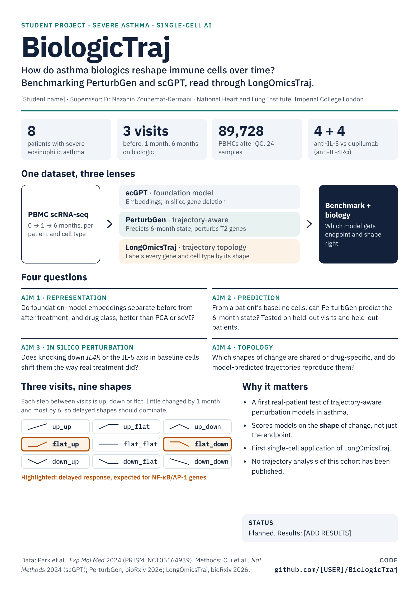

# BiologicTraj

**How do asthma biologics reshape circulating immune cells over time?**

BiologicTraj benchmarks a trajectory-aware perturbation model (PerturbGen) against a single-cell foundation model (scGPT) and simple baselines, using longitudinal PBMC single-cell RNA-seq from patients with severe eosinophilic asthma treated with biologics. [LongOmicsTraj](https://github.com/nzkermani/LongOmicsTraj) reads the results as trajectory topology: the direction and order of change across visits.

> **Status:** planned student project (MSc/BSc), National Heart and Lung Institute, Imperial College London. No results yet.

<p align="center">
  <a href="docs/BiologicTraj_poster.pdf"></a>
  <br><sub>Project poster: <a href="docs/BiologicTraj_poster.pdf">PDF (A4, scales to A0)</a></sub>
</p>

## Data

PBMC scRNA-seq from the PRISM study ([NCT05164939](https://clinicaltrials.gov/study/NCT05164939)), published in [Park et al., *Exp Mol Med* 2024](https://www.nature.com/articles/s12276-024-01368-y).

| | |
| --- | --- |
| Patients | 8 with severe eosinophilic asthma, all good clinical responders |
| Biologics | mepolizumab (2), reslizumab (2): anti-IL-5; dupilumab (4): anti-IL-4Rα |
| Visits | before treatment, 1 month, 6 months (24 samples) |
| Cells | 89,728 PBMCs after QC (10x Genomics) |

The data are not included in this repository and are not publicly deposited, as far as we know. Access goes through the study team.

## Aims

1. **Representation.** Do scGPT and PerturbGen embeddings separate cells before and after treatment, and by drug class, better than PCA or scVI, while preserving patient-to-patient biology?
2. **Trajectory prediction.** From a patient's baseline cells, can PerturbGen predict the 6-month state better than scGPT-based and naive baselines? Tested on held-out visits and held-out patients.
3. **In silico perturbation.** Does knocking down a drug's target pathway in baseline cells (*IL4R* for dupilumab, the IL-5 axis for anti-IL-5) shift them the way real treatment did?
4. **Trajectory topology.** Which genes, cell populations and pathways follow which shapes of change across the three visits? Which shapes are shared or drug-specific, and do model-predicted trajectories reproduce them?

## Tools

| Tool | Role | Reference |
| --- | --- | --- |
| [scGPT](https://www.nature.com/articles/s41592-024-02201-0) | Single-cell foundation model: cell embeddings, in silico gene deletion | Cui et al., *Nat Methods* 2024 |
| [PerturbGen](https://perturbgen.cog.sanger.ac.uk/docs/index.html) | Trajectory-aware generative model: predicts later cell states, perturbs genes along a trajectory | [bioRxiv 2026](https://www.biorxiv.org/content/10.64898/2026.03.04.709254.full.pdf) |
| [LongOmicsTraj](https://github.com/nzkermani/LongOmicsTraj) | R package: encodes change between visits as up/down/flat into Ordinal Trajectory States (9 possible with 3 visits) | [bioRxiv 2026](https://www.biorxiv.org/content/10.64898/2026.08.18.745427.full.pdf) |

Baselines: PCA on highly variable genes, scVI, and naive "no change" and "mean shift" predictors. Every comparison uses patient-level splits.

Model training is in Python. LongOmicsTraj runs in R:

```r
devtools::install_github("nzkermani/LongOmicsTraj")
```

## Repository layout

```
docs/   project poster (PNG, PDF)
```

Code folders will be added as the project starts.

## References

1. Park K, Lee JH, Shin E, et al. Single-cell RNA sequencing reveals transcriptional changes in circulating immune cells from patients with severe asthma induced by biologics. *Exp Mol Med* 2024;56:2755–2762. doi:10.1038/s12276-024-01368-y
2. Cui H, Wang C, Maan H, et al. scGPT: toward building a foundation model for single-cell multi-omics using generative AI. *Nat Methods* 2024;21:1470–1480. doi:10.1038/s41592-024-02201-0
3. Chi Hao Ly K, Miraki Feriz A, et al. Predicting how perturbations reshape cellular trajectories with PerturbGen. *bioRxiv* 2026. doi:10.64898/2026.03.04.709254
4. Zounemat-Kermani N, Richardson M, Faiz A, et al. Topology-based query framework for longitudinal omics trajectories. *bioRxiv* 2026. doi:10.64898/2026.08.18.745427

## Contact

Dr Nazanin Zounemat-Kermani, National Heart and Lung Institute, Imperial College London.
