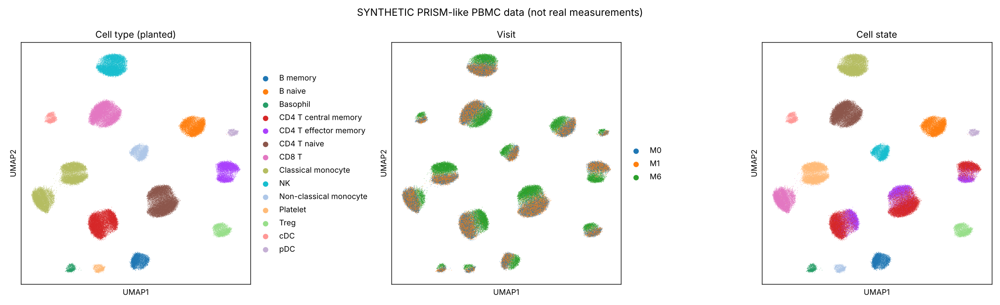
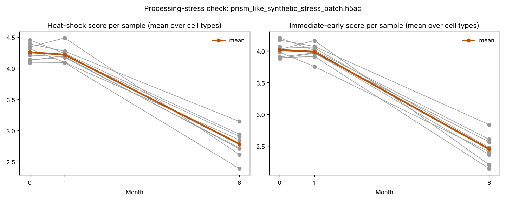

# BiologicTraj

**How do asthma biologics reshape circulating immune cells over time?**

BiologicTraj benchmarks a trajectory-aware perturbation model (PerturbGen) against a single-cell foundation model (scGPT) and simple baselines, using longitudinal PBMC single-cell RNA-seq from patients with severe eosinophilic asthma treated with biologics. [LongOmicsTraj](https://github.com/nzkermani/LongOmicsTraj) reads the results as trajectory topology: the direction and order of change across visits.

> **Status:** student project (MSc/BSc), National Heart and Lung Institute, Imperial College London. The analysis pipeline runs end to end on **simulated** data with known answers; the real PRISM data are not yet in hand. The foundation-model steps (Aims 1–3) are not built yet.

<p align="center">
  <a href="docs/BiologicTraj_poster.pdf"></a>
  <br><sub>Project poster: <a href="docs/BiologicTraj_poster.pdf">PDF (A4, scales to A0)</a></sub>
</p>

## Data

PBMC scRNA-seq from the PRISM study ([NCT05164939](https://clinicaltrials.gov/study/NCT05164939)), published in [Park et al., *Exp Mol Med* 2024](https://www.nature.com/articles/s12276-024-01368-y).

| | |
| --- | --- |
| Patients | 8 with severe eosinophilic asthma, all good clinical responders |
| Biologics | mepolizumab (2), reslizumab (2): anti-IL-5; dupilumab (4): anti-IL-4Rα |
| Visits | before treatment, 1 month, 6 months (24 samples) |
| Cells | 89,728 PBMCs after QC (10x Genomics) |

The data are not included in this repository and are not publicly deposited, as far as we know. Access goes through the study team. Along with the counts, we need per-sample **processing date, time-to-freeze, sequencing batch and oral corticosteroid dose** (see [Known risks](#known-risks)).

## Aims

1. **Representation.** Do scGPT and PerturbGen embeddings separate cells before and after treatment, and by drug class, better than PCA or scVI, while preserving patient-to-patient biology?
2. **Trajectory prediction.** From a patient's baseline cells, can PerturbGen predict the 6-month state better than scGPT-based and naive baselines? Tested on held-out visits and held-out patients.
3. **In silico perturbation.** Dupilumab blocks a receptor (IL-4Rα), so knocking down *IL4R* in baseline cells is a reasonable gene-level analogue and the primary test. Anti-IL-5 antibodies neutralise a secreted ligand acting on other cells (mainly eosinophils, absent from PBMCs), so a gene knockdown is a weak proxy; there the comparison is with cytokine-response programmes (e.g. the [Immune Dictionary](https://pmc.ncbi.nlm.nih.gov/articles/PMC10781646) and the [Human Cytokine Dictionary](https://www.biorxiv.org/content/10.64898/2025.12.12.693897v1)).
4. **Trajectory topology.** Which genes, cell populations and pathways follow which shapes of change across the three visits? Which shapes are shared or drug-specific, and do model-predicted trajectories reproduce them?

## Pipeline

```
scRNA-seq (.h5ad)
 ├─ 1. stress_check.py           processing-stress screen: do heat-shock genes move with
 │                               immediate-early genes? (flags a likely handling artefact)
 ├─ 2. pseudobulk.py --mode sum   summed counts per sample × cell type
 ├─ 3. normalise_pseudobulk.R     edgeR TMM + limma-voom, patient blocking
 │                               → logCPM per visit + test for every transition (M0→M1, M1→M6)
 ├─ 4. run_longomicstraj.R        LongOmicsTraj shapes (OTS), empirical and/or mixed model,
 │                               fixed thresholds 0.25 / 0.35 / 0.5 and default "hybrid"
 └─ 5. score_longomicstraj.py     synthetic data only: score against the planted truth,
                                 with and without the limma support filter
```

One command per dataset:

```bash
scripts/run_pipeline.sh data/synthetic/prism_like_synthetic.h5ad results/synthetic/drug \
  data/synthetic/ground_truth_gene_topology.csv empirical
```

`empirical` takes about 4 minutes on a laptop-class CPU. Adding `lmm` fits one mixed model per gene per cell type (~20,000 fits, ~30 minutes on one core); with this balanced design it gave the same answers as the empirical estimator in an earlier run, so it is optional until there are missing visits.

## Synthetic benchmark

Until the PRISM data arrive, everything is tested on **simulated** data with the same design (8 patients, 3 visits, ~89k PBMCs, 14 cell types) and planted effects with known answers. Details: [data/synthetic/README.md](data/synthetic/README.md).

```bash
python scripts/simulate_prism_like.py --out data/synthetic --scenario drug           # ~20 s
python scripts/simulate_prism_like.py --out data/synthetic --scenario stress_batch   # ~20 s
```

<p align="center"></p>

There are two scenarios. In **drug**, the late fall of NF-κB/AP-1 genes is a real drug effect. In **stress_batch**, there is no such effect: the 6-month samples were simply processed in a lower-stress batch. This reproduces the published signal as an artefact.

### Results (empirical estimator, seed 42)

| Scenario | Threshold | Planted shapes recovered | False calls among truly flat rows | Stress check |
| --- | --- | --- | --- | --- |
| drug | 0.35 | 548/553 | 294 / 9,582 (3.1%) | no flag |
| drug | 0.35 + limma support | **553/553** | **3 (0.03%)** | no flag |
| drug | default "hybrid" | 537/553 | 3,798 (39.6%) | no flag |
| drug | "hybrid" + limma support | 553/553 | 3 (0.03%) | no flag |
| stress_batch | 0.35 + limma support | 106/106 | 465 (4.5%), almost all artefactual stress genes | **flagged, both drug classes, 100% of cell types** |

What this shows:

1. **The support filter matters more than the threshold.** Requiring each up/down transition to be significant in limma removes nearly all false calls at every threshold, including the LongOmicsTraj default, which is too permissive when most genes are flat. Drug-specific queries go from 2–8% to 75–100% precision with full recall.
2. **Statistics cannot tell an artefact from biology.** In the stress scenario, 465 of 468 artefactual stress-gene trajectories pass the support filter, and the "shared delayed suppression" query returns 254 genes of which 23 are real. Only the stress check catches it.
3. **Depleted cell types drop out.** Anti-IL-5 depletes basophils below 20 cells per sample, so their planted effects (21 rows) cannot be analysed as gene trajectories; they need a composition analysis.

<p align="center"><br><sub>Stress check, stress_batch scenario: heat-shock and immediate-early scores fall together at 6 months in every patient.</sub></p>

These numbers are an upper bound: the simulation has no ambient RNA, doublets or unstructured batch effects, and the pipeline uses the true cell labels.

## Known risks

From a critical review of the design:

- **Processing artefact.** The genes behind the published 6-month change (*FOS, FOSB, JUN, JUNB, DUSP1, ZFP36, IER2, EGR1, NFKBIA, CD69*) are classic sample-handling stress genes. Run the stress check and compare against processing and sequencing metadata before interpreting any trajectory.
- **Confounding with time.** There is no untreated control; two dupilumab patients withdrew oral corticosteroids, which act directly on NF-κB; season changes over six months.
- **Blood is not the airway.** PBMCs exclude eosinophils, neutrophils and airway cells.
- **Composition vs expression.** State switches (IL1B+ → S100A+ monocytes, CD4 S0 → S1) and depleted populations need a composition analysis alongside gene trajectories.
- **Power.** Four patients per drug class, all responders: trajectory shapes are descriptive; report their stability (e.g. leave one patient out).
- **Foundation models.** Gene-perturbation models have not consistently beaten simple linear baselines in independent benchmarks ([Ahlmann-Eltze et al.](https://www.biorxiv.org/content/10.1101/2024.09.16.613342.full.pdf)); keep the baselines.

## Next steps

- [ ] Cell annotation from clustering instead of true labels; add ambient RNA and batch effects to the simulator
- [ ] Composition analysis (cell types and states per visit)
- [ ] Leave-one-patient-out stability of trajectory shapes
- [ ] Zero-shot scGPT embeddings (Aim 1), then PerturbGen fine-tuning on HPC (Aims 2–3)
- [ ] Request PRISM counts plus processing, batch and steroid metadata

## Tools

| Tool | Role | Reference |
| --- | --- | --- |
| [scGPT](https://www.nature.com/articles/s41592-024-02201-0) | Single-cell foundation model: cell embeddings, in silico gene deletion | Cui et al., *Nat Methods* 2024 |
| [PerturbGen](https://perturbgen.cog.sanger.ac.uk/docs/index.html) | Trajectory-aware generative model: predicts later cell states, perturbs genes along a trajectory | [bioRxiv 2026](https://www.biorxiv.org/content/10.64898/2026.03.04.709254.full.pdf) |
| [LongOmicsTraj](https://github.com/nzkermani/LongOmicsTraj) | R package: encodes change between visits as up/down/flat into Ordinal Trajectory States (9 possible with 3 visits) | [bioRxiv 2026](https://www.biorxiv.org/content/10.64898/2026.08.18.745427.full.pdf) |
| edgeR / limma | Pseudobulk count model with patient blocking, transition tests | Bioconductor |

### Environment

Python: `pip install anndata scanpy`. R: edgeR, limma and LongOmicsTraj (`devtools::install_github("nzkermani/LongOmicsTraj")`). LongOmicsTraj's DESCRIPTION asks for R ≥ 4.6; the results here were produced under R 4.5.3 with that requirement relaxed locally, where its full test suite (100 tests) passes.

## Repository layout

```
scripts/
  simulate_prism_like.py     synthetic data, two scenarios, with ground truth
  export_background_genes.R  real gene symbols for background genes (msigdbr)
  check_synthetic.py         UMAP + quick recovery check
  stress_check.py            processing-stress screen
  pseudobulk.py              pseudobulk (sum or mean)
  normalise_pseudobulk.R     edgeR/limma-voom + transition tests
  run_longomicstraj.R        LongOmicsTraj on pseudobulk
  score_longomicstraj.py     score against ground truth
  run_pipeline.sh            all of the above for one dataset
data/synthetic/              ground truth (the .h5ad files are regenerated, not committed)
results/synthetic/           scores and stress checks per scenario
docs/                        poster and figures
```

## References

1. Park K, Lee JH, Shin E, et al. Single-cell RNA sequencing reveals transcriptional changes in circulating immune cells from patients with severe asthma induced by biologics. *Exp Mol Med* 2024;56:2755–2762. doi:10.1038/s12276-024-01368-y
2. Cui H, Wang C, Maan H, et al. scGPT: toward building a foundation model for single-cell multi-omics using generative AI. *Nat Methods* 2024;21:1470–1480. doi:10.1038/s41592-024-02201-0
3. Chi Hao Ly K, Miraki Feriz A, et al. Predicting how perturbations reshape cellular trajectories with PerturbGen. *bioRxiv* 2026. doi:10.64898/2026.03.04.709254
4. Zounemat-Kermani N, Richardson M, Faiz A, et al. Topology-based query framework for longitudinal omics trajectories. *bioRxiv* 2026. doi:10.64898/2026.08.18.745427
5. van den Brink SC, Sage F, Vértesy Á, et al. Single-cell sequencing reveals dissociation-induced gene expression in tissue subpopulations. *Nat Methods* 2017;14:935–936.
6. Ahlmann-Eltze C, Huber W, Anders S. Deep-learning-based gene perturbation effect prediction does not yet outperform simple linear baselines. 2025 (preprint: [bioRxiv 2024.09.16.613342](https://www.biorxiv.org/content/10.1101/2024.09.16.613342)).
7. Cui A, Huang T, Li S, et al. Dictionary of immune responses to cytokines at single-cell resolution. *Nature* 2024;625:377–384.

## Contact

Dr Nazanin Zounemat-Kermani, National Heart and Lung Institute, Imperial College London.
